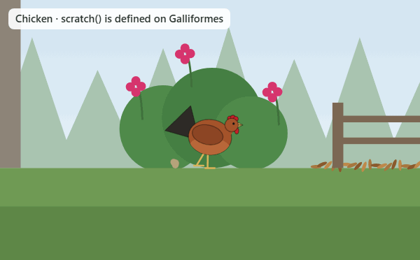

# Bird Behaviors

Learn to identify birds by what they do. Pick a species, watch it in its habitat, and trigger the behaviors you would see in the field.

**[Open the live app](https://kyzarky.github.io/bird-behaviors/)** · [The chicken in the class explorer](https://kyzarky.github.io/bird-behaviors/#/class/gallus-gallus-domesticus)



## Why it exists

An interviewer asked me what I would consider when designing a chicken in an object-oriented, class-based way. I kept thinking about it afterward, and this is the longer answer: sixteen birds I can see from my yard in Gardiner, Washington, or down at the beach, plus the chicken, as a TypeScript class hierarchy that follows real taxonomy.

```
Bird ─ Galliformes ─ Phasianidae ─ Gallus ─ Chicken
```

Each class says only how it differs from its parent. The app's second tab reads the hierarchy back out of the running classes, so you can see where every behavior and every number comes from.

## Read more

| Topic | |
| --- | --- |
| [The chicken question](docs/the-chicken-question.md) | What belongs on `Chicken`, what belongs above it, and where inheritance stops helping |
| [Behaviors](docs/behaviors.md) | How a behavior is written, and the three ways a subclass changes one |
| [The flight model](docs/flight-model.md) | Twelve numbers, one flight routine, seventeen different fliers |
| [Rendering](docs/rendering.md) | Drawing any bird from proportions and a pose, with no graphics library |
| [Design system](docs/design-system.md) | How the interface uses [`@kyzarky/ui`](https://github.com/KyzarKy/design-system) |
| [Roadmap](ROADMAP.md) | What is next |

## Run it

```bash
npm install
npm run dev
```

`npm run verify` runs the typecheck, the tests (every behavior of every species, run headless to completion), and a production build.

**Stack:** TypeScript (strict), React 19, Vite, Tailwind CSS 4, `@kyzarky/ui`, Vitest, and the browser's 2D canvas. GitHub Actions verifies each push and publishes to GitHub Pages.

## How this was built

I wanted to see whether Claude Fable 5.2 could build a project like this from a single prompt. I was the architect of the object-oriented schema: inheritance that follows taxonomy from `Bird` down to species, behaviors defined at the level where they arise, and flight as one shared method driven by per-class parameters. Claude wrote the first working version from that specification in one pass, which is the first commit. The purpose of the project is to show how I think about concepts like inheritance, so the hierarchy is the part to read.

## Edges

- Sizes and distances are stylized so a hummingbird and a heron are both readable on one stage.
- Plumage is a handful of color regions: enough to tell species apart, short of a field guide.
- The flight numbers are estimates from natural-history descriptions.
- The scene is always daylight, in the dark theme too.
